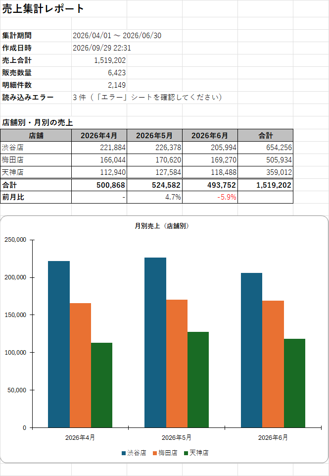
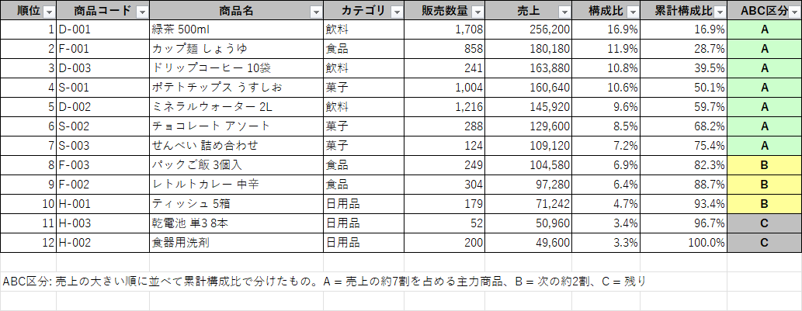
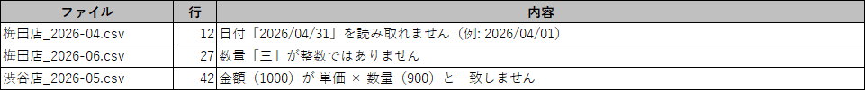

# 売上集計ツール（sales-report）

店舗ごとにバラバラの形式で届く売上ファイル（CSV・Excel）をまとめて読み込み、月次の集計帳票をExcelで出力するツールです。
毎月の「各店舗のファイルを開いてコピペして集計する」作業を、ファイルを置いてダブルクリックするだけにすることを想定して作りました。



## できること

- フォルダ内のCSV・Excel（.csv / .xlsx / .xls）をまとめて読み込む
- 店舗別・月別・商品別・カテゴリ別に集計し、1つのExcelファイルに出力する
- 月別売上の棒グラフ、前月比、商品のABC分析を付ける
- 読み込めなかった行は処理を止めず、ファイル名・行番号・理由を一覧にする

### 出力する帳票

| シート | 内容 |
|---|---|
| サマリー | 集計期間、売上合計、店舗×月の表、前月比、月別売上のグラフ |
| 店舗別 | 店舗ごとの売上・構成比・販売数量 |
| 商品別 | 売上ランキング、構成比、累計構成比、ABC区分 |
| カテゴリ別 | カテゴリ×月の表 |
| 明細 | 全ファイルの明細（元のファイル名と行番号付き、フィルター付き） |
| エラー | 読み込めなかった行と理由 |



読み込めなかった行は「エラー」シートにまとめます。元のファイルのどこを直せばいいかが分かるように、行番号はファイル上の行番号をそのまま出しています。



## 使い方（ツールを使う人向け）

1. `sales-report-dist.zip`を展開する（GitHubのReleasesからダウンロードできます）
2. `input`フォルダに売上ファイルを入れる（最初はサンプルが入っています）
3. `売上集計.bat`をダブルクリックする
4. 終わると `output`フォルダが開き、`売上集計_日付_時刻.xlsx`ができている

Java 21以降が必要です。入っていない場合は、batが「Java が見つかりません」と表示してインストール先のURLを案内します。

コマンドラインから実行する場合は次のとおりです。

```bash
java -jar sales-report.jar [入力フォルダ] [出力フォルダ]   # 省略時は input と output
```

## 入力ファイルの形式

1行目が見出し、2行目以降が明細です。列の順番は問いません。

| 列 | 必須 | 見出しとして認識する名前 |
|---|---|---|
| 日付 | ○ | 日付、売上日、販売日、date |
| 店舗 | ○ | 店舗、店舗名、店名、store |
| 商品コード | ○ | 商品コード、品番、JANコード、product_code |
| 商品名 | ○ | 商品名、品名、product_name |
| 単価 | ○ | 単価、販売単価、unit_price |
| 数量 | ○ | 数量、個数、販売数、quantity |
| カテゴリ | | カテゴリ、カテゴリー、分類、category |
| 金額 | | 金額、売上金額、売上、amount |

- 日付は`2026/04/01`、`2026-4-1`、`2026年4月1日`、`20260401`、Excelの日付セルを読めます
- 数値は`1,200`、`¥1,200`、`1200円`、全角数字も読めます
- 数量のマイナスは返品として売上から差し引きます
- 金額列がある場合は、`単価 × 数量`と一致するかチェックします

## 作りで気をつけた点

クラウドソーシングの「集計の自動化」案件でよくある、「店舗や担当者ごとにファイルの形式が少しずつ違う」状況を想定しています。
サンプルデータ（[samples/input](samples/input)）も、3店舗であえて形式を変えています。エラーの表示を確かめられるように、間違えた行も3件入れました（存在しない日付、漢数字の数量、単価 × 数量と合わない金額）。実行すると「読み込めなかった行が 3 件あります」と出ますが、これは想定どおりの動きです。

| 店舗 | 形式 |
|---|---|
| 渋谷店 | UTF-8（BOM付き）のCSV、金額列あり |
| 梅田店 | Shift_JISのCSV（Excelで「CSV（コンマ区切り）」保存したもの）、見出しの名前と列の順番が違う、金額列なし |
| 天神店 | Excel、日付は日付セル、金額は数式 |

### 文字コードは自動で判定する

BOMがあるか、UTF-8として正しく読めるかで判定し、読めなければWindows-31J（Shift_JISにWindowsの機種依存文字を足したもの）として読みます。「①」や「㈱」が入ったExcel出力のCSVでも文字化けしません（[CharsetDetector.java](src/main/java/io/github/aoshig1213/salesreport/reader/CharsetDetector.java)）。

### 不正な行があっても止めない

1行のミスで全体が止まるツールは、毎月の運用では使いづらいと考えています。読める行だけで集計して、問題のある行はエラーシートに理由を出します。1行に問題が複数あれば全部並べるので、一度の修正で済みます。

### エラーの行番号はファイル上の行番号と合わせる

CSVライブラリの初期設定では空行が読み飛ばされて、行番号がずれます。作っている途中にテストで気づいたので、空行も数える設定にしました。

### 細かいところ

- Excelでファイルを開いている間にできる一時ファイル（`~$〜.xlsx`）は読み飛ばす
- グラフは画像ではなく、表のセルを参照するExcelのグラフにした。Excel上で数字を直すとグラフも変わる
- 依存ライブラリ込みのjar、ダブルクリックで動くbat、使い方のテキスト、サンプルデータを1つのzipにまとめた（`./mvnw package`で作成）

## テスト

テストは36件です。サンプルデータから実際に帳票を作って、中身を読み戻して確かめるテストも入れています。

| テストクラス | 内容 |
|---|---|
| `RowParserTest` | 日付・数値の書き方の揺れ、金額の不一致、返品、複数エラーの表示 |
| `ColumnMappingTest` | 列の並び順、見出しの別名、必須列がないとき |
| `CharsetDetectorTest` | UTF-8（BOMあり・なし）、Shift_JIS、機種依存文字 |
| `SalesFileLoaderTest` | CSV・Excelの読み込み、エラー行の行番号、壊れたファイル、一時ファイルの除外 |
| `SalesAggregatorTest` | 店舗×月の集計、売上がない月、構成比、返品、ABC区分 |
| `MainTest` | サンプルデータから帳票を作る一連の流れ、入力がないときの終了コード |

```bash
./mvnw test
```

## 使った技術

- Java 21
- Apache POI 5.5（Excelの読み書き、グラフ）
- Apache Commons CSV
- JUnit 5、AssertJ
- Maven（maven-shade-pluginで実行用jar、maven-assembly-pluginで配布用zip）

## ディレクトリ構成

```
src/main/java/io/github/aoshig1213/salesreport/
├── Main.java    コマンドラインの入口
├── reader/      CSV・Excelの読み込み、列の特定、1行ごとの検証
├── aggregate/   集計（店舗×月、商品ランキング、ABC分析）
├── writer/      Excel帳票の出力
└── model/       明細・エラーのデータ
src/dist/        配布用のbatと使い方
samples/input/   サンプルデータ（3店舗×3か月）
```

## 今後やりたいこと

- 集計する月を指定するオプション
- 前年同月比（データが1年分以上あるとき）
- 帳票のPDF出力
